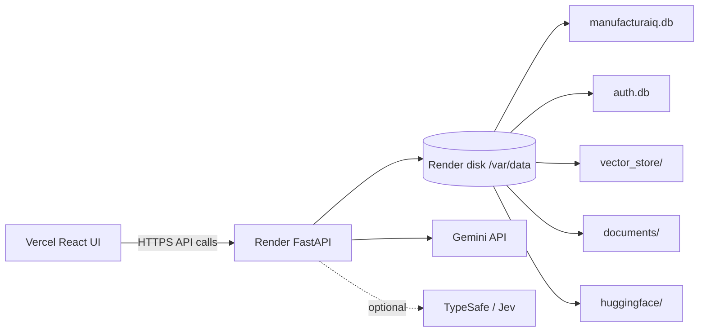

# ManufacturaIQ Deployment Guide

ManufacturaIQ is currently a prototype/demo deployment: React + Vite on Vercel, FastAPI on Render, and local persistent state on a Render disk.

## Deployment Architecture



## Important Prototype Limitations

- This guide is for a prototype/demo deployment, not a production-ready multi-tenant system.
- Authentication is optional; Guest Mode is supported.
- Knowledge-base documents are shared by the prototype backend.
- There is no per-user document isolation or multi-tenant authorization.
- Document upload/list/delete endpoints are not protected by auth in the current backend.
- For public internet demos, either add authorization before exposing document-management endpoints or set `DOCUMENT_UPLOAD_ENABLED=false`.

## Persistent Storage Requirement

A Render persistent disk is required for the current ManufacturaIQ prototype. Mount it at:

```text
/var/data
```

The disk is required for:

- manufacturing SQLite state: `/var/data/manufacturaiq.db`
- local auth database: `/var/data/auth.db`
- static Qdrant corpus: `/var/data/vector_store`
- dynamic PDF originals and registry: `/var/data/documents`
- dynamic Qdrant vectors: `/var/data/documents/vectors`
- optional Hugging Face model cache: `/var/data/huggingface`

Without the disk, auth users, uploaded PDFs, dynamic vectors, and restored static RAG state can disappear across redeploys or restarts.

## Render Backend

### Service Configuration

Create a Render Web Service from `https://github.com/eswarb-dev/CMTI.git`.

| Setting | Value |
| --- | --- |
| Root directory | `backend` |
| Runtime | Python 3.12 |
| Build command | `pip install -e .` |
| Start command | `uvicorn app.main:app --host 0.0.0.0 --port $PORT` |
| Health check path | `/health` |

The editable install command is valid because `backend/pyproject.toml` declares the backend package and runtime dependencies.

### Persistent Disk

Attach the Render disk before relying on the app. Use `/var/data` as the mount path.

### Environment Variables

Set these in Render. Do not commit real values.

```env
APP_ENV=production
LOG_LEVEL=INFO
CORS_ALLOWED_ORIGINS=["https://your-vercel-app.vercel.app"]

AUTH_JWT_SECRET=<generate-a-long-random-secret>
AUTH_DATABASE_PATH=/var/data/auth.db
AUTH_ACCESS_TOKEN_MINUTES=480

DATABASE_URL=sqlite:////var/data/manufacturaiq.db
QDRANT_PATH=/var/data/vector_store

DOCUMENT_UPLOAD_ENABLED=true
DOCUMENT_STORAGE_PATH=/var/data/documents
DOCUMENT_MAX_UPLOAD_MB=50
DOCUMENT_DYNAMIC_COLLECTION=manufacturaiq_dynamic_documents
DOCUMENT_INGEST_BATCH_SIZE=32

EMBEDDING_MODEL=BAAI/bge-small-en-v1.5
EMBEDDING_WARMUP_ENABLED=false
QUERY_EMBEDDING_CACHE_SIZE=128
QUERY_TOTAL_TIMEOUT_SECONDS=20
HF_HOME=/var/data/huggingface

GEMINI_API_KEY=<your-gemini-api-key>
GEMINI_MODEL=gemini-3.8-flash
GEMINI_FALLBACK_MODEL=gemini-3.5-flash-lite
GEMINI_MODEL_FALLBACK_ENABLED=true
GEMINI_THINKING_LEVEL=low
GEMINI_TOTAL_BUDGET_SECONDS=15
GEMINI_PRIMARY_TIMEOUT_SECONDS=6
GEMINI_REQUEST_TIMEOUT_SECONDS=10
GEMINI_RETRY_BACKOFF_SECONDS=0.5
GEMINI_MAX_ATTEMPTS=2
GEMINI_MAX_OUTPUT_TOKENS=3072

TYPESAFE_API_KEY=<optional-typesafe-key>
TYPESAFE_MODEL=<optional-typesafe-model>
JEV_ENABLED=true
JEV_REVIEW_ENABLED=true
JEV_ROUTE_THRESHOLD=0.50
JEV_TIMEOUT_SECONDS=10
JEV_MAX_RETRIES=1
```

`GEMINI_FALLBACK_MODEL` and `GEMINI_MODEL_FALLBACK_ENABLED` are implemented by the current Gemini reasoner. If `TYPESAFE_API_KEY` is not set, deterministic routing fallback is used and final review can fail closed to `HUMAN_REVIEW`.

`EMBEDDING_WARMUP_ENABLED=false` gives faster Render startup and a slower first retrieval. `true` warms the BGE model at startup but may delay health checks on small instances.

Generate a JWT secret locally:

```powershell
python -c "import secrets; print(secrets.token_urlsafe(48))"
```

### Manufacturing Database Restore

The deploy branch excludes `manufacturaiq.db`. A fresh Render disk will not contain structured manufacturing data until you restore or bootstrap it.

The current SQLite URL format is supported:

```env
DATABASE_URL=sqlite:////var/data/manufacturaiq.db
```

Supported strategies:

- Restore a prepared `manufacturaiq.db` artifact to `/var/data/manufacturaiq.db`.
- If the normalized demo-factory parquet dataset is available on the deployed service, run:

```bash
python -m app.db.initializer --database /var/data/manufacturaiq.db
```

Then validate:

```bash
python -m app.db.validation --database /var/data/manufacturaiq.db
```

Do not let the service start as if structured evidence exists when this database is missing.

### Static RAG Restore

The deploy branch excludes the local static vector-store artifacts and bulky corpus build artifacts. A fresh Render deployment without the static corpus will not provide the same document-answering behavior as the local prototype.

The static Qdrant path is configured by:

```env
QDRANT_PATH=/var/data/vector_store
```

Supported options:

- Preferred prototype method: restore a prepared static vector-store artifact to `/var/data/vector_store`.
- Rebuild the static index once from the source PDFs in a Render shell, then keep it on the persistent disk:

```bash
python -m app.rag.ingestion --force
python -m app.rag.validation
```

Local validation currently expects 21 RAG checks to pass and 2,193 static vectors when the full corpus is present.

### Auth Database

The local default remains:

```text
<project>/backend/data/auth.db
```

For Render, set:

```env
AUTH_DATABASE_PATH=/var/data/auth.db
```

This keeps local prototype accounts on the persistent disk and separate from `manufacturaiq.db`.

### Dynamic Document Storage

For Render, set:

```env
DOCUMENT_STORAGE_PATH=/var/data/documents
DOCUMENT_DYNAMIC_COLLECTION=manufacturaiq_dynamic_documents
```

The current implementation creates:

```text
/var/data/documents/
  originals/
  processing/
  registry/
    documents.db
  vectors/
```

Uploaded PDFs are not written into production, maintenance, quality, alarm, or telemetry SQLite tables.

### Hugging Face Cache

The BGE embedding model is `BAAI/bge-small-en-v1.5`. The first run may download model weights from Hugging Face.

Recommended:

```env
HF_HOME=/var/data/huggingface
```

This persists the model cache across redeploys. It is independent of Gemini. `HF_TOKEN` is not required for this public model.

### Deployment Preflight

After configuring the disk and environment, run:

```bash
python scripts/deployment_preflight.py
```

The script is read-only. It checks configured paths, provider presence, CORS, and whether TypeSafe will use fallback. It never prints API key values.

Example output:

```text
ManufacturaIQ Deployment Preflight

Persistent root         : PASS
Manufacturing DB        : PASS
Auth DB path            : PASS
Static RAG store        : PASS
Document storage        : PASS
Hugging Face cache      : PASS
Gemini configured       : PASS
TypeSafe configured     : OPTIONAL/FALLBACK
CORS configured         : PASS
```

## Vercel Frontend

### Project Configuration

Create a Vercel project from the same GitHub repository.

| Setting | Value |
| --- | --- |
| Framework preset | Vite |
| Root directory | `frontend` |
| Build command | `npm run build` |
| Output directory | `dist` |

### Environment Variables

Set:

```env
VITE_API_BASE_URL=https://your-render-service.onrender.com
```

Do not put backend secrets in Vercel. `VITE_*` variables are compiled into the browser bundle.

### CORS

After Vercel deploys, copy the exact Vercel production URL into Render:

```env
CORS_ALLOWED_ORIGINS=["https://your-vercel-app.vercel.app"]
```

The JSON-list format is accepted by the current Pydantic settings configuration. Do not use a wildcard production origin.

## Guest Mode and Local Accounts

Authentication is optional in this prototype.

- Guest Mode works without an account.
- Users can create a local account through the UI.
- Users can sign in through the UI.
- `POST /api/auth/register`, `POST /api/auth/login`, `GET /api/auth/me`, and `POST /api/auth/logout` are implemented.
- `python scripts/create_local_user.py` remains available as an optional admin/bootstrap command from the Render shell.

## Knowledge Base Security Boundary

The current knowledge base is shared at the backend level. Dynamic uploads are not isolated per user, and document-management endpoints are currently accessible without an auth dependency. For public demos, prefer a trusted audience, disable uploads with `DOCUMENT_UPLOAD_ENABLED=false`, or add endpoint authorization in a later pass.

## Deployment Order

1. Create the Render Web Service.
2. Attach a persistent disk at `/var/data`.
3. Configure the verified Render environment variables.
4. Restore or bootstrap `/var/data/manufacturaiq.db`.
5. Restore or rebuild `/var/data/vector_store`.
6. Set `AUTH_DATABASE_PATH=/var/data/auth.db`.
7. Set `DOCUMENT_STORAGE_PATH=/var/data/documents`.
8. Start the Render backend.
9. Run `python scripts/deployment_preflight.py`.
10. Verify `/health`.
11. Verify `/ready`.
12. Verify static RAG with `python -m app.rag.validation`.
13. Deploy the Vercel frontend.
14. Set `VITE_API_BASE_URL` in Vercel.
15. Add the final Vercel URL to Render `CORS_ALLOWED_ORIGINS`.
16. Redeploy or restart Render if needed.
17. Open the frontend.
18. Test Guest chat.
19. Test account creation.
20. Test one static manual query.
21. Upload one PDF.
22. Query the uploaded PDF.
23. Delete the test PDF.

## Verification

Backend:

```bash
python -m pytest -q
python -m app.db.validation
python -m app.rag.validation
python scripts/deployment_preflight.py
```

Frontend:

```bash
npm test
npm run build
npm run lint
```

Health endpoints:

```text
https://your-render-service.onrender.com/health
https://your-render-service.onrender.com/ready
```

## Troubleshooting

Frontend says Offline: verify Render `/health` and Vercel `VITE_API_BASE_URL`.

Static document answers are missing: the static vector store was likely not restored or rebuilt.

Local account disappears after redeploy: `AUTH_DATABASE_PATH` is likely not set to `/var/data/auth.db` or the disk is missing.

Uploaded PDFs disappear after redeploy: `DOCUMENT_STORAGE_PATH` is likely not set to `/var/data/documents` or the disk is missing.

First retrieval is slow: BGE model loading/cache warmup is occurring. Set `HF_HOME=/var/data/huggingface` and consider `EMBEDDING_WARMUP_ENABLED=true` after the cache is warm.

Gemini returns `HUMAN_REVIEW`: the provider may be unavailable, timed out, returned invalid output, or final review fell back. Inspect provider status metadata and Render logs.

`401` from `/api/auth/me` in Guest Mode: expected when no authenticated bearer token is present.
