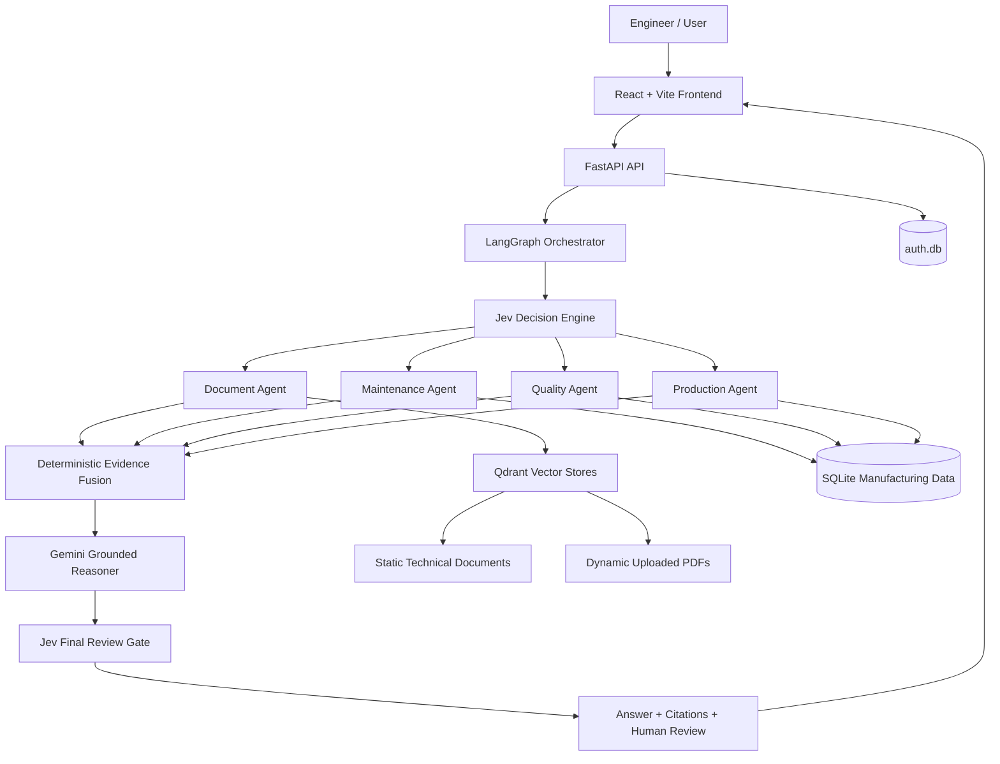
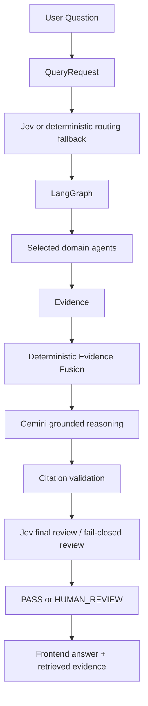
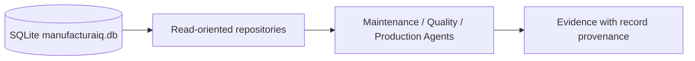
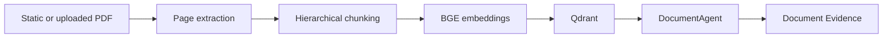
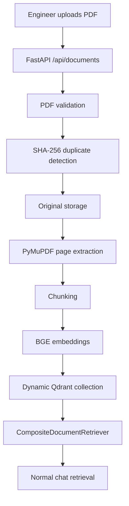

# ManufacturaIQ

Evidence-Grounded Manufacturing Engineering Copilot

ManufacturaIQ is a domain-focused manufacturing engineering copilot that combines structured plant data, technical documentation, retrieval, deterministic engineering services, agent orchestration, and grounded LLM reasoning. It is currently a local research/prototype system, not a machine-control system or safety-certified product.

## Overview

Manufacturing engineers often need to answer questions using information scattered across machine manuals, SOPs, safety documents, production records, maintenance history, quality inspections, alarms, telemetry, and engineering knowledge bases. ManufacturaIQ provides a natural-language interface over those heterogeneous sources while preserving evidence IDs, source provenance, and human-review boundaries.

The current prototype supports technical-document retrieval, structured manufacturing evidence retrieval, deterministic evidence fusion, Gemini-grounded reasoning, Jev/TypeSafe-style decision interfaces with deterministic fallback, LangGraph orchestration, a FastAPI backend, and a React/Vite frontend with local chat history and knowledge-base management.

## Problem

Manufacturing troubleshooting is rarely contained in one system. A question such as "Why are rejects increasing on this machine?" may require production order data, quality inspection rows, alarm history, maintenance logs, telemetry summaries, and OEM documentation. ManufacturaIQ is designed to gather those facts first, reason only over supplied evidence, and keep citations visible so a qualified engineer can review the result.

ManufacturaIQ does not autonomously control machinery, replace approved engineering procedures, or replace qualified personnel.

## Current Prototype Capabilities

- Document retrieval over a static technical corpus and dynamic uploaded PDFs.
- Maintenance evidence retrieval from maintenance logs, alarms, and telemetry summaries.
- Quality evidence retrieval from inspection records and quality summaries.
- Production evidence retrieval from production orders and rejection summaries.
- Deterministic evidence fusion with duplicate handling and source-integrity conflict reporting.
- Gemini grounded reasoning over bounded evidence, with validated evidence-ID citations.
- Primary/fallback Gemini model failover within one total reasoning budget.
- Jev/TypeSafe decision-engine interface for routing and review, with deterministic missing-key fallback.
- LangGraph route -> agent fan-out -> fusion -> reasoning -> review workflow.
- Fail-closed `HUMAN_REVIEW` behavior when provider reasoning or review is unavailable.
- React chat UI with citations, retrieved evidence, human-review indicators, backend status, settings, Guest mode, and optional local sign-in.
- Knowledge Base and Uploads views for PDF upload, list, status, and delete.
- Local browser conversation history with deterministic first-query titles.
- FastAPI public endpoints for health, readiness, query, document management, and local auth.
- SQLite-backed structured manufacturing data, document registry, and local prototype accounts.
- Qdrant local vector stores for static and dynamic document chunks.
- Offline evaluation harness and dynamic knowledge-base evaluation artifacts.

## System Architecture



Jev decides WHAT should run. LangGraph handles HOW and WHEN those components execute. When TypeSafe/Jev credentials are unavailable, routing falls back to deterministic agent selection and final review fails closed to `HUMAN_REVIEW`.

## Query Processing Pipeline



Routing selects required agents. Agents gather facts and evidence; they do not perform unrestricted free-form reasoning. Fusion remains deterministic. Gemini receives a bounded evidence bundle and must cite real evidence IDs. Review fails closed when reasoning is unavailable, malformed, unsupported, or unsafe.

## Structured Data Pipeline



The structured path uses SQLite repositories, not arbitrary SQL generated by an LLM. Current structured data includes:

- `machines`
- `products`
- `production_orders`
- `maintenance_logs`
- `quality_inspections`
- `machine_alarms`
- `telemetry`

Individual structured evidence preserves record identity where it represents one row. Aggregate evidence, such as telemetry summaries, uses truthful summary provenance with `record_id=None` rather than pretending one row represents all contributors.

## RAG / Document Pipeline



The static RAG system uses the local embedding model `BAAI/bge-small-en-v1.5` with 384-dimensional normalized embeddings and Qdrant cosine search. Retrieval combines vector search with deterministic lexical/reranking signals. Document evidence carries document ID, chunk ID, page range, source file, headings, retrieval score, and neighboring chunk previews.

Verified static corpus:

| Item | Value |
|---|---|
| Static collection | `manufacturaiq_documents` |
| Static source dataset | `manufacturaiq_document_corpus` |
| Source PDFs | 4 |
| Pages | 2,173 |
| Chunks / vectors | 2,193 |
| Embedding model | `BAAI/bge-small-en-v1.5` |
| Embedding dimension | 384 |

Canonical static documents:

- Haas Mill Operator Manual
- Haas Lathe Operator Manual
- SINUMERIK 828D Milling manual
- OSHA Lockout/Tagout document

## Domain Agents

| Agent | Purpose | Primary source |
|---|---|---|
| DocumentAgent | Retrieve relevant technical documentation without interpreting it | Qdrant static + dynamic corpora |
| MaintenanceAgent | Retrieve maintenance logs, alarm evidence, recurrence counts, and telemetry summaries | SQLite maintenance, alarm, and telemetry repositories |
| QualityAgent | Retrieve inspection rows and quality/failure summaries | SQLite quality repository |
| ProductionAgent | Retrieve production orders and rejection summaries | SQLite production repository |

Agents intentionally return evidence, warnings, errors, and metadata. They do not diagnose root cause, calculate unimplemented metrics such as OEE, execute machine actions, or bypass the fusion/reasoning/review pipeline.

## Orchestration with LangGraph

The implemented graph is:

```text
START
  -> route
  -> conditional Send fan-out to selected domain agents
  -> fusion
  -> reason
  -> review
  -> END
```

`selected_agents` from routing is the source of truth for which domain agents run. Agent results fan in through a deterministic reducer. Resource ownership is handled by the FastAPI lifespan: the embedding model, document resources, orchestrator, auth repository, and dynamic document store are constructed once and closed on shutdown when app-owned.

## Decision and Review Layer

The Jev/TypeSafe decision layer is intended for bounded classification and decision logic:

- domain routing
- final review checks
- provider-status metadata
- fail-closed behavior

Jev is not used for long-form engineering reasoning. The current prototype starts and operates without a TypeSafe key. In that mode:

- routing uses deterministic fallback;
- review returns `HUMAN_REVIEW`;
- no TypeSafe provider call is required.

Live TypeSafe routing/review quality is not claimed by the current offline evaluation artifacts.

## Grounded LLM Reasoning

Gemini runs after deterministic evidence retrieval and fusion. It does not access databases, Qdrant, files, or tools directly. The reasoner sends a bounded evidence payload and requires structured output:

- `observations`
- `possible_causes`
- `recommended_checks`
- `missing_information`
- `answer`
- `answer_evidence_ids`

Citations must reference supplied evidence IDs. Invalid citations, malformed JSON, empty output, failed interaction status, missing keys, or provider errors return `ProviderStatus.UNAVAILABLE` rather than fabricated reasoning.

Current Gemini defaults from configuration:

| Setting | Default |
|---|---|
| Primary model | `gemini-3.8-flash` |
| Fallback model | `gemini-3.5-flash-lite` |
| Fallback enabled | `true` |
| Thinking level | `low` |
| Max output tokens | `3072` |
| Total Gemini budget | `15s` |
| Primary model timeout | `6s` |

Provider calls are application-deadlined with `asyncio.timeout(...)`; SDK internal retries are bounded so the application controls model failover. If both models fail, evidence remains visible and the workflow still ends in controlled `HUMAN_REVIEW`.

## Dynamic Knowledge Base

Dynamic PDFs are uploaded into a persistent local knowledge base, not attached transiently to one chat turn.



Dynamic documents are separate from the immutable static corpus.

| Aspect | Static | Dynamic |
|---|---|---|
| IDs | `DOC-*` | `USR-*` |
| Files | `datasets/` artifacts | `data/documents/` |
| Qdrant path | `D:\CMTI\vector_store` | `D:\CMTI\data\documents\vectors` |
| Collection | `manufacturaiq_documents` | `manufacturaiq_dynamic_documents` |
| Dataset label | `manufacturaiq_document_corpus` | `manufacturaiq_dynamic_documents` |

Implemented dynamic behavior:

- PDF validation by signature and parser.
- Size cap, default 50 MB.
- SHA-256 duplicate detection.
- Original-file storage using system-controlled names.
- PyMuPDF page extraction.
- Chunking with the same project chunking configuration.
- BGE embeddings in batches.
- Separate dynamic Qdrant collection.
- Composite static + dynamic retrieval.
- List, detail, upload, and delete API.
- Delete removes vectors, original file, then registry row.
- Failed ingestion never reports `READY`.

Known dynamic limitations:

- PDF only.
- No OCR for image-only/scanned PDFs.
- Encrypted/password-protected PDFs are rejected.
- Ingestion is synchronous.
- Uploaded PDF text is treated as data, including prompt-like text.
- Static corpus is not rebuilt when dynamic documents change.

## Data Sources

ManufacturaIQ separates data sources:

1. Synthetic demo factory data in SQLite for structured manufacturing evidence.
2. Normalized external manufacturing datasets as independent sources.
3. Static technical document corpus from manuals and safety documentation.
4. User-uploaded dynamic PDFs in the local knowledge base.

External datasets are independent sources. They should not be treated as linked to synthetic factory machine IDs unless code explicitly maps them.

## Evidence, Provenance, and Grounding

The core application currency is `Evidence`. Evidence includes `EvidenceProvenance`, source type, title, content, optional machine/product/batch scope, retrieval or decision scores, and metadata.

Document evidence includes document and page provenance. Structured evidence includes record IDs when it represents individual records. `EvidenceBundle` carries fused evidence, conflicts, missing-information entries, warnings, and metadata.

The record-identity review found that individual production, maintenance, alarm, and quality record IDs are preserved for returned individual rows. Some aggregate evidence cannot enumerate every contributing row under the current frozen provenance contract. This is documented as a design limitation, not fabricated provenance.

## Frontend

The frontend is a React + Vite + TypeScript application. Verified UI capabilities include:

- Chat interface.
- New Chat.
- Browser-local conversation history.
- Deterministic title from first query.
- Retrieved Evidence panel.
- Sources & Evidence settings panel.
- Citation display and source labels.
- Human Review banner/status.
- Knowledge Base view.
- Uploads view.
- PDF upload modal and document deletion.
- Backend Online/Offline status.
- Settings panel.
- Guest mode.
- Optional Sign In and Create Account flows.

The frontend uses `VITE_API_BASE_URL` when provided, otherwise `http://localhost:8000`.

## Conversations

Conversation history is currently browser-side. The main localStorage keys are:

- `manufacturaiq.conversations.v1`
- `manufacturaiq.activeConversationId.v1`

The first query creates a conversation. The title is derived deterministically from that first query. Conversations persist in the local browser, not on the server. There is no server-side conversation synchronization yet.

## Local Prototype Authentication

Local authentication is optional for prototype usage. Guest mode is supported.

Implemented local auth behavior:

- `POST /api/auth/register`
- `POST /api/auth/login`
- `GET /api/auth/me`
- `POST /api/auth/logout`
- users stored in `backend/data/auth.db`
- passwords hashed with bcrypt
- JWT access tokens signed with `AUTH_JWT_SECRET`
- access-token lifetime controlled by `AUTH_ACCESS_TOKEN_MINUTES`
- profile/account state surfaced in the frontend settings experience

Limitations:

- no cloud sync
- no server-side chat history
- no per-user document isolation
- no OAuth/SSO/Active Directory
- role is prototype/profile metadata, not fine-grained authorization

## Data Stores

| Store | Purpose |
|---|---|
| `backend/data/manufacturaiq.db` | structured manufacturing data |
| `backend/data/auth.db` | local prototype user accounts |
| `data/documents/registry/documents.db` | dynamic document metadata |
| `vector_store` / `manufacturaiq_documents` | canonical static manual vectors |
| `data/documents/vectors` / `manufacturaiq_dynamic_documents` | uploaded-PDF vectors |
| browser `localStorage` | conversation/session UI state |

## Backend API

| Method | Endpoint | Purpose |
|---|---|---|
| `GET` | `/health` | process liveness |
| `GET` | `/ready` | app wiring readiness |
| `POST` | `/api/query` | run one query through routing, agents, fusion, reasoning, review |
| `POST` | `/api/documents` | upload and ingest one PDF |
| `GET` | `/api/documents` | list dynamic documents |
| `GET` | `/api/documents/{document_id}` | fetch one dynamic document record |
| `DELETE` | `/api/documents/{document_id}` | delete one dynamic document |
| `POST` | `/api/auth/register` | create a local prototype account |
| `POST` | `/api/auth/login` | authenticate and receive a bearer token |
| `GET` | `/api/auth/me` | fetch current authenticated profile |
| `POST` | `/api/auth/logout` | client-side logout instruction |

The API response does not expose embeddings, vector-store paths, provider request bodies, API keys, database URLs, or secret values.

## Project Structure

```text
CMTI/
├── backend/
│   ├── app/
│   │   ├── agents/
│   │   ├── api/
│   │   ├── auth/
│   │   ├── contracts/
│   │   ├── core/
│   │   ├── db/
│   │   ├── decision/
│   │   ├── documents/
│   │   ├── fusion/
│   │   ├── orchestration/
│   │   ├── rag/
│   │   ├── reasoning/
│   │   └── repositories/
│   ├── data/
│   └── tests/
├── frontend/
│   └── src/
├── datasets/
├── docs/
├── reports/
├── scripts/
├── tests/
├── vector_store/
└── start.ps1
```

## Running the Prototype

Preferred startup:

```powershell
cd D:\CMTI
.\start.ps1
```

This starts:

- backend: `http://127.0.0.1:8000`
- frontend: `http://localhost:5173`

Health checks:

- `http://127.0.0.1:8000/health`
- `http://127.0.0.1:8000/ready`

Manual backend:

```powershell
cd D:\CMTI\backend
D:\CMTI\.venv\Scripts\python.exe -m uvicorn app.main:app --host 127.0.0.1 --port 8000
```

Manual frontend:

```powershell
cd D:\CMTI\frontend
npm install
npm run dev
```

Project interpreter:

```text
D:\CMTI\.venv\Scripts\python.exe
Python 3.12.10
```

## Environment Configuration

Use `backend/.env.example` as the safe template. Do not commit real secrets.

```env
APP_ENV=development
LOG_LEVEL=INFO
DATABASE_URL=
QDRANT_PATH=

EMBEDDING_MODEL=BAAI/bge-small-en-v1.5
EMBEDDING_WARMUP_ENABLED=true
QUERY_EMBEDDING_CACHE_SIZE=128

TYPESAFE_API_KEY=
TYPESAFE_MODEL=

GEMINI_API_KEY=
GEMINI_MODEL=gemini-3.8-flash
GEMINI_FALLBACK_MODEL=gemini-3.5-flash-lite
GEMINI_MODEL_FALLBACK_ENABLED=true
GEMINI_THINKING_LEVEL=low
GEMINI_TOTAL_BUDGET_SECONDS=15
GEMINI_PRIMARY_TIMEOUT_SECONDS=6
GEMINI_REQUEST_TIMEOUT_SECONDS=10
GEMINI_RETRY_BACKOFF_SECONDS=0.5
GEMINI_MAX_ATTEMPTS=2
GEMINI_MAX_OUTPUT_TOKENS=3072
QUERY_TOTAL_TIMEOUT_SECONDS=20

DOCUMENT_UPLOAD_ENABLED=true
DOCUMENT_STORAGE_PATH=D:\CMTI\data\documents
DOCUMENT_MAX_UPLOAD_MB=50
DOCUMENT_DYNAMIC_COLLECTION=manufacturaiq_dynamic_documents
DOCUMENT_INGEST_BATCH_SIZE=32

AUTH_JWT_SECRET=
AUTH_ACCESS_TOKEN_MINUTES=480
```

Frontend:

```env
VITE_API_BASE_URL=http://127.0.0.1:8000
```

`.env` files are intended for local configuration and must not contain committed secrets.

## Usage Examples

Example prompts compatible with the prototype:

- "What are the steps for spindle warm-up on a Haas mill?"
- "How does tool wear monitoring work in SINUMERIK 828D?"
- "What steps must workers complete before servicing a machine under lockout/tagout?"
- "Compare Haas Safe Run with SINUMERIK collision avoidance."
- "Show the quality failures for SHAFT-A."

Structured scope fields such as `machine_id`, `product_id`, `batch_id`, and time range can be sent through the API. The chat UI currently sends query text directly.

## Evaluation and Validation

Evaluation artifacts distinguish offline deterministic behavior from live provider quality.

Offline core evaluation (`reports/evaluation/20260927T191500_formal`, 70 cases):

| Metric | Result |
|---|---:|
| Routing exact match | 1.000 |
| Clarification correctness | 1.000 |
| Expected source types present | 1.000 |
| Document hit | 1.000 |
| Retrieval Hit@1 | 0.917 |
| Retrieval MRR | 0.958 |
| Provenance completeness | 1.000 |
| Provider fail-closed | 1.000 |
| Fusion duplicates absent | 1.000 |
| Safety no-bypass | 1.000 |
| Record identity recall | 0.445 |

The record-identity score reflects documented aggregate/limit behavior, not fabricated IDs.

Dynamic knowledge-base evaluation (`reports/evaluation/documents/20260927T205246_dynamickb` plus STEP 20A diagnostics):

| Metric | Result |
|---|---:|
| Upload success rate | 1.000 |
| READY rate | 1.000 |
| Validation rejection correctness | 1.000 |
| Duplicate detection accuracy | 1.000 |
| Dynamic Hit@1 | 0.947 |
| Dynamic Hit@5 | 1.000 |
| Dynamic MRR | 1.000 |
| Document hit rate | 1.000 |
| Page hit rate | 1.000 |
| Delete success | 1.000 |
| Determinism rate | 1.000 |
| Static vectors after evaluation | 2,193 |

Live Gemini behavior depends on provider availability. Live TypeSafe/Jev quality is not claimed by the offline evaluation because TypeSafe credentials were unavailable in those runs.

## Testing

The repository contains tests for:

- domain agents
- repositories
- RAG retrieval
- Gemini reasoning
- Jev decision/review fallback
- LangGraph orchestration
- FastAPI routes
- dynamic document ingestion
- local authentication
- evaluation harness
- frontend React/Vitest behavior
- DB validation
- RAG validation
- root data-pipeline/demo-factory tests

Common commands:

```powershell
cd D:\CMTI\backend
D:\CMTI\.venv\Scripts\python.exe -m pytest -q
D:\CMTI\.venv\Scripts\python.exe -m app.db.validation
D:\CMTI\.venv\Scripts\python.exe -m app.rag.validation

cd D:\CMTI
D:\CMTI\.venv\Scripts\python.exe -m pytest D:\CMTI\tests -q

cd D:\CMTI\frontend
npm test
npm run build
npm run lint
```

## Performance Notes

- The embedding model is application-owned.
- BGE loads and warms once during backend startup when the app owns the orchestrator.
- Normal query handling does not re-chunk PDFs.
- Query retrieval is vector/lexical search over existing static and dynamic chunks.
- Gemini provider calls have bounded application-level deadlines and model failover.
- External provider availability can still affect response latency.
- Retrieved evidence remains visible when reasoning fails.

## Safety and Failure Behavior

If external reasoning is unavailable:

- retrieved evidence remains available;
- reasoning is marked `UNAVAILABLE`;
- final review becomes `HUMAN_REVIEW`;
- the system does not fabricate a grounded engineering answer.

`HUMAN_REVIEW` does not necessarily mean retrieval failed. It can mean the review layer is unavailable, provider reasoning failed, or the result requires a person to inspect evidence before action.

## Prototype Security Boundaries

- Gemini and TypeSafe API keys are backend-only.
- The frontend contains no provider secrets.
- `.env` is local configuration and should not be committed with real values.
- PDF filenames are untrusted; stored names are system-controlled.
- Upload storage rejects traversal-style names and validates PDF structure.
- Upload size is capped.
- Passwords are hashed with bcrypt, not stored plaintext.
- JWTs require `AUTH_JWT_SECRET`.
- PDF text is treated as data, not executable instructions.
- The prototype does not claim enterprise security certification.

## Design Principles

- Evidence before reasoning.
- Deterministic logic stays deterministic.
- LLMs do not query databases directly.
- Fail closed when reasoning or review is unavailable.
- Preserve provenance.
- Keep static and dynamic corpora isolated.
- Never fabricate citations.
- Provider absence must not prevent application startup.
- Human review remains explicit for uncertain, unavailable, or unsafe output.

## Implementation Status

| Area | Status |
|---|---|
| Dataset preparation | Implemented |
| Synthetic demo factory | Implemented |
| Technical document corpus | Implemented |
| Backend contracts | Implemented |
| SQLite repositories | Implemented |
| Hierarchical RAG | Implemented |
| Document Agent | Implemented |
| Maintenance Agent | Implemented |
| Quality Agent | Implemented |
| Production Agent | Implemented |
| Jev decision layer | Implemented with fallback |
| Evidence Fusion | Implemented |
| Gemini reasoner | Implemented |
| Gemini provider failover | Implemented |
| Final review gate | Implemented with fallback |
| LangGraph orchestration | Implemented |
| FastAPI API | Implemented |
| React frontend | Prototype |
| Dynamic PDF ingestion | Implemented |
| Document management API | Implemented |
| Knowledge Base UI | Implemented |
| Evaluation harness | Implemented |
| Local authentication | Prototype |
| Conversation history | Browser-local prototype |
| Latency hardening | Implemented |

# Not Implemented / Deferred

### TypeSafe/Jev Live Provider Access

The architecture supports TypeSafe/Jev provider calls, but the prototype is verified to operate with missing credentials through deterministic fallback routing and fail-closed review. Do not read offline fallback metrics as live Jev accuracy.

### OCR

Image-only/scanned PDFs are not OCR'd. PDFs with no extractable text are rejected.

### Encrypted PDFs

Password-protected PDFs are rejected. The system does not crack or unlock encrypted documents.

### Temporary Chat Attachments

PDFs are uploaded into the persistent local knowledge base. There is no ChatGPT-style temporary attachment pipeline.

### Server-Side Conversation Persistence

Conversation history is browser-local. There is no server-side conversation database or synchronization.

### Cloud Synchronization

No cloud account, document, or chat sync is implemented.

### Per-User Document Isolation

The dynamic knowledge base is shared for the local prototype. Authenticated users do not get isolated document collections.

### Enterprise Authentication

OAuth, SSO, Active Directory, and enterprise identity providers are not implemented.

### Fine-Grained RBAC

Roles are local prototype/profile metadata. Fine-grained authorization is not implemented.

### Background Ingestion Workers

PDF ingestion is synchronous. There is no Celery, Kafka, RabbitMQ, Redis queue, or worker service.

### Additional Document Conversion

DOCX, PPTX, image OCR, web crawling, and broad document conversion are not implemented in the dynamic knowledge base.

### Autonomous Machine Control

ManufacturaIQ does not directly operate CNC machinery or execute control actions.

### Safety Certification

The project is not safety-certified.

### Automatic Root-Cause Truth

LLM output remains evidence-grounded engineering assistance. It is not proof of root cause and should be reviewed by qualified personnel.

### Full Industrial Deployment

The current system is a local prototype, not a hardened industrial deployment.

### Multi-Tenant Architecture

Multi-tenant isolation is not implemented.

### Production Deployment Hardening

Reverse proxy, HTTPS, centralized logging, monitoring, secret manager integration, container orchestration, backup strategy, and production operations work remain future scope unless added separately.

## Future Work

- Live Jev/TypeSafe integration when provider access is available.
- OCR for scanned/image-only PDFs.
- Temporary per-chat attachments.
- Per-user knowledge bases.
- Server-side conversation history.
- SSO and fine-grained RBAC.
- Asynchronous document ingestion with progress updates.
- Deployment/containerization hardening.
- Observability and structured operational metrics.
- Additional manufacturing agents.
- ERP, MES, CMMS, and historian connectors.
- Evaluation on real industrial datasets.
- Human feedback loop for review outcomes.

## Prototype Disclaimer

ManufacturaIQ is currently a research/prototype engineering decision-support system. It should not be treated as an autonomous machine-control system or a substitute for approved engineering procedures, qualified personnel, OEM documentation, or workplace safety requirements.
