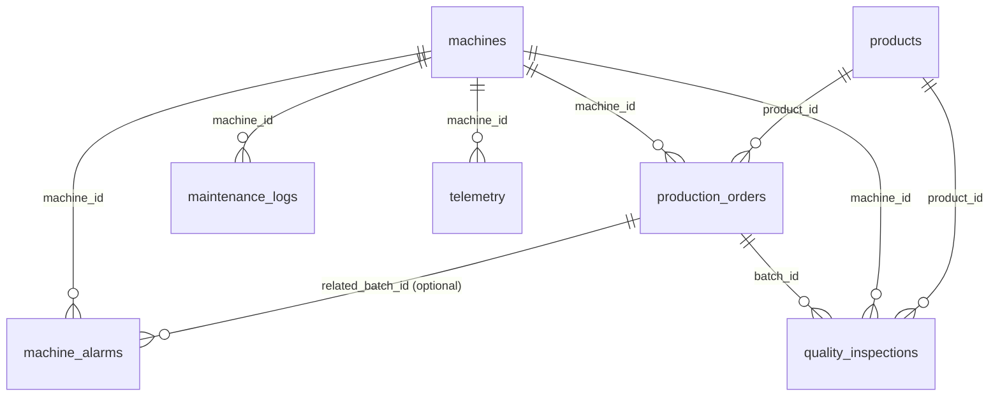

# STEP 05 — Operational Database and Repositories

This document describes the ManufacturaIQ **operational SQLite database**, its
schema, initialization/validation commands, the repository layer, the external
data boundary, and the SQL safety policy introduced in STEP 05.

---

## 1. Database location and configuration

| Item | Value |
| --- | --- |
| Default database file | `backend/data/manufacturaiq.db` (i.e. `D:\CMTI\backend\data\manufacturaiq.db`) |
| Configuration key | `DATABASE_URL` (STEP 04 `Settings`, no second config loader) |
| Supported URL forms | plain path, `sqlite:///relative/path.db`, `sqlite:////abs/path.db`, `sqlite://abs/path.db` |
| Fallback | empty/missing `DATABASE_URL` → `project_root/backend/data/manufacturaiq.db` |

Repository and connection code never hardcode `D:\CMTI`; the path is always
resolved through `app.core.config.Settings`.

## 2. Schema version

```
DATABASE_SCHEMA_VERSION = "1"
```

There is **no migration framework** yet. Re-running the initializer recreates
the generated local prototype database, but only after a full successful,
validated import (see §5). Ordinary runtime never destroys an existing database.

## 3. SQLite settings

Applied on every relevant connection:

| PRAGMA | Value | Reason |
| --- | --- | --- |
| `foreign_keys` | `ON` | referential integrity is enforced, never disabled |
| `journal_mode` | `WAL` | concurrent readers during development/runtime |
| `busy_timeout` | `5000` ms | writer contention tolerance |

## 4. Schema

### 4.1 Tables, primary keys, foreign keys

| Table | Primary key | Foreign keys |
| --- | --- | --- |
| `machines` | `machine_id` | — |
| `products` | `product_id` | — |
| `production_orders` | `production_id` | `machine_id → machines.machine_id`, `product_id → products.product_id` |
| `maintenance_logs` | `maintenance_id` | `machine_id → machines.machine_id` |
| `quality_inspections` | `inspection_id` | `batch_id → production_orders.batch_id`, `machine_id → machines.machine_id`, `product_id → products.product_id` |
| `machine_alarms` | `alarm_id` | `machine_id → machines.machine_id`, `related_batch_id → production_orders.batch_id` (nullable) |
| `telemetry` | `telemetry_id` | `machine_id → machines.machine_id` |
| `database_metadata` | `id = 1` (single row) | — |

Additional uniqueness: `production_orders.batch_id` has a **UNIQUE index**
(`idx_production_orders_batch_id`) so it can act as a foreign-key target.

Columns are derived from the **actual** `datasets/normalized/demo_factory`
Parquet schemas; the initializer fails on schema drift instead of inventing or
dropping columns. Every data table carries `is_synthetic` and `source_dataset`.

`database_metadata` stores: `schema_version`, `dataset_source`,
`generator_version`, `imported_at`, `source_manifest_hash`. It never stores
evaluation ground truth.

### 4.2 ER diagram (conceptual)



Reading order: `machines → production_orders → quality_inspections`;
`machines → maintenance_logs / machine_alarms / telemetry`;
`products → production_orders → quality_inspections`.

### 4.3 Indexes

| Table | Index | Columns |
| --- | --- | --- |
| production_orders | idx_production_orders_batch_id (UNIQUE) | batch_id |
| production_orders | idx_production_orders_machine_id | machine_id |
| production_orders | idx_production_orders_product_id | product_id |
| production_orders | idx_production_orders_actual_start_time | actual_start_time |
| quality_inspections | idx_quality_inspections_machine_id | machine_id |
| quality_inspections | idx_quality_inspections_product_id | product_id |
| quality_inspections | idx_quality_inspections_batch_id | batch_id |
| quality_inspections | idx_quality_inspections_timestamp | timestamp |
| quality_inspections | idx_quality_inspections_machine_timestamp | (machine_id, timestamp) |
| maintenance_logs | idx_maintenance_logs_machine_id | machine_id |
| maintenance_logs | idx_maintenance_logs_created_at | created_at |
| maintenance_logs | idx_maintenance_logs_failure_code | failure_code |
| maintenance_logs | idx_maintenance_logs_machine_created | (machine_id, created_at) |
| machine_alarms | idx_machine_alarms_machine_id | machine_id |
| machine_alarms | idx_machine_alarms_timestamp | timestamp |
| machine_alarms | idx_machine_alarms_alarm_code | alarm_code |
| machine_alarms | idx_machine_alarms_machine_timestamp | (machine_id, timestamp) |
| telemetry | idx_telemetry_machine_id | machine_id |
| telemetry | idx_telemetry_timestamp | timestamp |
| telemetry | idx_telemetry_machine_timestamp | (machine_id, timestamp) |

No speculative indexes beyond this list.

### 4.4 Value policies

* **Timestamps** — stored as ISO-8601 `TEXT` with the original offset
  preserved (`2026-09-01T08:00:00+05:30`, dataset timezone `Asia/Kolkata`).
  Offsets are never stripped. Repositories parse them back into timezone-aware
  `datetime` objects in internal records.
* **Booleans** — stored as `INTEGER` 0/1; repositories expose Python `bool`.
* **NULLs** — preserved as-is (e.g. `defect_type`, `failure_code`,
  `acknowledged_at`, `related_batch_id`).

## 5. Initialization

**Canonical command** (from `D:\CMTI\backend`):

```
python -m app.db.initializer
```

Equivalent script: `python scripts\init_database.py`
(optional flags: `--database PATH`, `--source DIR`, `--json`).

Sequence:

1. Validate that all seven demo-factory Parquet files exist.
2. Inspect the actual Parquet schemas (fail on drift).
3. Build `manufacturaiq.db.tmp` with `PRAGMA foreign_keys = ON`.
4. Create schema + indexes.
5. Import in FK-safe order: `machines → products → production_orders →
   maintenance_logs → quality_inspections → machine_alarms → telemetry`.
6. Write `database_metadata`.
7. Verify row counts against the source Parquet, `PRAGMA foreign_key_check`,
   index presence, and application invariants.
8. Only after everything passes: atomically `os.replace` the target file.

A failed run deletes the temp file and **preserves the existing database**.
Sidecar files (`-wal`, `-shm`) are removed before the rename.

### Validated invariants

| Invariant | Behaviour on violation |
| --- | --- |
| `accepted_quantity + rejected_quantity = actual_quantity` | initialization **fails** |
| `PASS` iff `lsl <= measured_value <= usl` (values present) | initialization **fails** |
| `created_at <= started_at <= completed_at` (values present) | initialization **fails** |
| `acknowledged = false` ⇒ `acknowledged_at IS NULL` | reported as a **warning**, never rewritten |
| row counts == source Parquet row counts | initialization **fails** |
| `PRAGMA foreign_key_check` empty | initialization **fails** |

Current demo dataset counts (read from Parquet, not hardcoded as schema
constants): machines 3, products 3, production_orders 180,
quality_inspections 900, maintenance_logs 75, machine_alarms 51,
telemetry 38,379.

## 6. Validation command

```
python -m app.db.validation
```

Reports: database path, schema version, per-table row counts (and expected
counts), foreign-key status, index presence, critical invariant status,
acknowledgement warnings, and an overall `VALID`/`INVALID` verdict. Exit code
is `0` only when valid. `--json` emits a machine-readable report.

## 7. Connection manager

`app.db.connection.DatabaseConnection`:

* resolves the DB path from `DATABASE_URL`/settings,
* opens `aiosqlite` connections with `row_factory = sqlite3.Row`,
* enables `foreign_keys`, `busy_timeout`, WAL,
* guarantees closure via the `async with database.connection():` helper,
* offers internal `fetch_one` / `fetch_all` helpers used by repositories.

No dependency-injection framework is used.

## 8. Repository layer

Repositories live in `app.repositories`, are **async**, return typed internal
records (`app.db.models` — private persistence structures, *not* shared
contracts), always use **parameterized queries**, and never expose raw SQL.

Common conventions:

* **Ordering** — time-based retrieval returns **newest first**
  (`DESC`, primary key `DESC` tie-break), except telemetry time-series lists
  which are **oldest first** (`ASC`); `latest_for_machine` returns the newest
  sample. Master-data lists (`machines`, `products`) are `ASC` by id.
* **Bounded results** — every list method takes `limit` (defaults: 100 for
  production/maintenance/quality/alarms, 500 for telemetry, hard cap 5000).
  Aggregates are explicit `summarize_*` methods.
* **Time filters** — accept `datetime`, `date`, or ISO `str`; production uses
  `actual_start_time`, maintenance `created_at`, quality/alarms/telemetry
  `timestamp`.

| Repository | Methods |
| --- | --- |
| `MachineRepository` | `get_by_id`, `list_all`, `exists` |
| `ProductRepository` | `get_by_id`, `list_all`, `exists` |
| `ProductionRepository` | `get_by_production_id`, `get_by_batch_id`, `list_by_machine`, `list_by_product`, `list_by_machine_and_product`, `summarize_rejections` |
| `MaintenanceRepository` | `get_by_id`, `list_by_machine`, `list_by_failure_code`, `list_by_machine_and_time_range`, `recent_for_machine` |
| `QualityRepository` | `get_by_id`, `list_by_machine`, `list_by_product`, `list_by_batch`, `list_by_machine_and_time_range`, `list_failures`, `summarize_results` |
| `AlarmRepository` | `get_by_id`, `list_by_machine`, `list_by_code`, `list_by_machine_and_time_range`, `recent_for_machine`, `count_occurrences` |
| `TelemetryRepository` | `get_by_id`, `list_by_machine_and_time_range`, `latest_for_machine`, `summarize` |
| `ExternalDatasetRepository` | `list_datasets`, `get_dataset_metadata`, `get_schema`, `sample_records` |

Deterministic metrics (pure SQL/Python, no models):

* `summarize_rejections` → `order_count`, `total_actual_quantity`,
  `total_accepted_quantity`, `total_rejected_quantity`, `reject_rate`
  (`None` when the denominator is 0 — never infinity).
* `summarize_results` → `inspection_count`, `pass_count`, `fail_count`,
  `failure_rate`, plus **per-parameter** min/max/mean. Unrelated parameters are
  never averaged together; top-level min/max/mean appear only when a single
  parameter is involved.
* `TelemetryRepository.summarize` → per available metric (`rpm`,
  `vibration_mm_s`, `temperature_c`, `current_a`, `load_pct`,
  `spindle_power_kw`): `count`, `min`, `max`, `mean`, `first`, `last`.

Repositories **do not** create evidence, call LLMs, diagnose failures, compute
semantic relevance, or invoke agents/Jev/LangGraph — that belongs to future
services built on top of them.

## 9. External dataset boundary

`ExternalDatasetRepository` is **read-only, Parquet-based, and whitelisted**:

| dataset_id | Allowed artifacts |
| --- | --- |
| `predictive_maintenance` | `machine_condition_observations` |
| `cnc_tool_wear` | `experiment_metadata`, `experiment_samples` |
| `steel_faults` | `quality_fault_records` |
| `industrial_maintenance` | `maintenance_work_orders`, `sensor_tag_catalog` |

Rules:

* Callers pass **dataset IDs and artifact names only** — never filesystem
  paths. Traversal characters and resolution outside
  `datasets/normalized/external` are rejected.
* External data is **never imported into the operational SQLite database**,
  never assigned `source_dataset = manufacturaiq_demo_factory`, and never
  linked to `CNC-01`/`CNC-03`/`CNC-05`.
* `app.db.initializer` explicitly refuses any source directory inside the
  external data root.
* Sample reads are clamped (max 100 rows); metadata comes from Parquet
  footers. No second analytics engine is built.

## 10. SQL safety policy

`app.db.sql_safety` validates that a statement is a **single read-only query**
(preparation for a possible future SQL-assisted path — it is **not**
natural-language-to-SQL):

Accepted:

* `SELECT …` (single statement, optional trailing `;`)
* `WITH … SELECT …`

Rejected (token-based checks, not a naive `startswith("select")`):

* `INSERT`, `UPDATE`, `DELETE`, `DROP`, `ALTER`, `CREATE`, `REPLACE`
* `ATTACH`, `DETACH`, `VACUUM`, `REINDEX`, `ANALYZE`, `PRAGMA`
* transaction control (`BEGIN`/`COMMIT`/`ROLLBACK`/`SAVEPOINT`/`RELEASE`)
* multiple statements, NUL bytes, over-long queries
* SQL comments (`--`, `/* */`) — including comment-based statement smuggling
* statements that fail SQLite compilation (syntax errors fail closed)

String literals and quoted identifiers are tokenized as opaque regions, so
`WHERE name = 'DROP TABLE x'` remains valid. There is **no generic
`execute_sql(user_sql)` API anywhere in the application**; repositories with
statement templates remain the sanctioned access path.

## 11. Ground-truth boundary

* The operational database is populated exclusively from
  `datasets/normalized/demo_factory`.
* Evaluation-only material under `datasets/synthetic/` is never read by
  application database code, tests, or this schema
  (`tests/test_ground_truth_boundary.py` enforces this for `app/`).
* STEP 04 shared contracts (`QueryRequest`, `Evidence*`, `AgentResult`,
  `RoutingDecision`, `ReasoningResult`, `ReviewDecision`, and the protocols)
  are unchanged in STEP 05; `app.db.models` records are private
  persistence-layer structures and are **not** exported from `app.contracts`.

## 12. Tests

| Location | Coverage |
| --- | --- |
| `backend/tests/db/` | schema creation, schema↔Parquet match, initializer import + row counts, foreign-key cleanliness, metadata, determinism, failed-init preservation, external-source refusal, validation detectors, connection pragmas, SQL safety accept/reject matrix |
| `backend/tests/repositories/` | `CNC-05` machine/production/quality/maintenance/alarm/telemetry queries, `SHAFT-A` product queries, bounded limits, ordering, deterministic summaries, injection-safe parameterization, external whitelist/path-traversal |

Run everything:

```
cd D:\CMTI\backend
pytest
```
