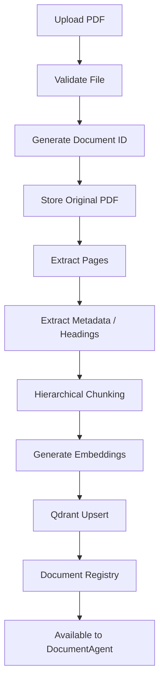
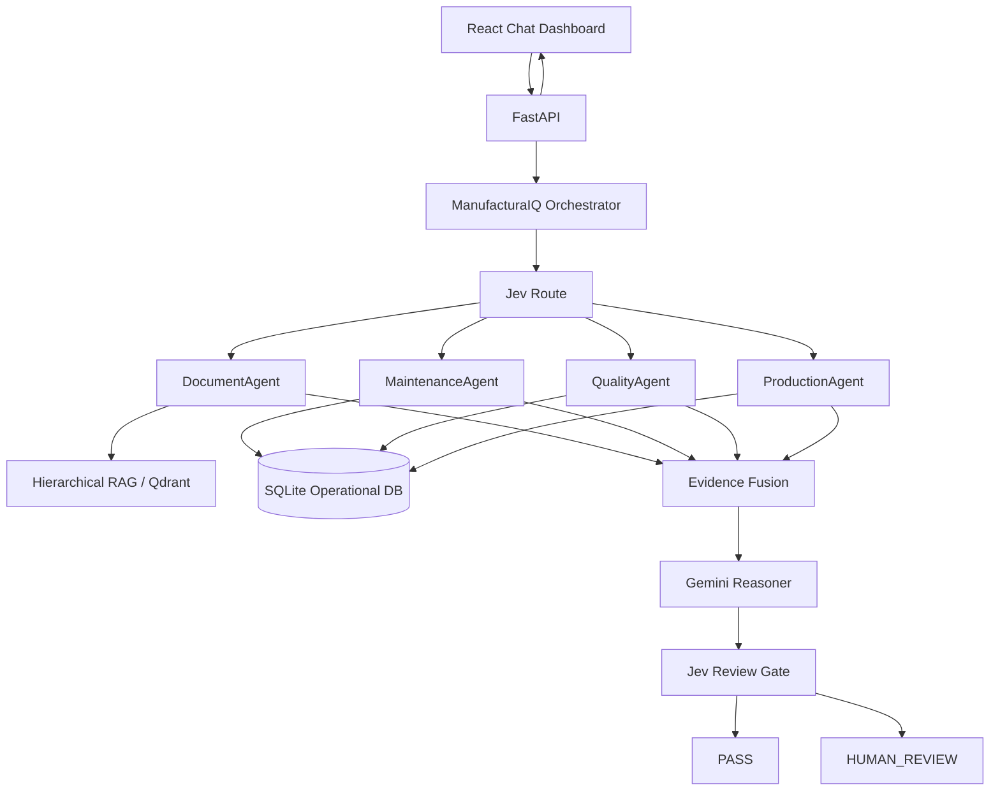
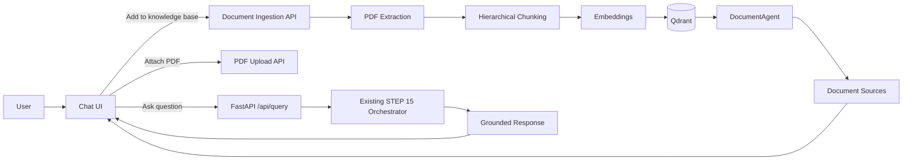
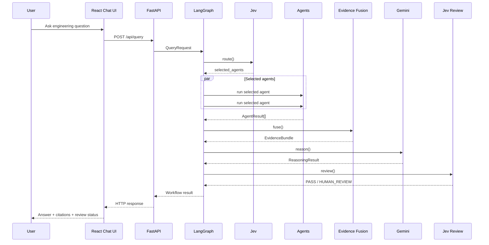
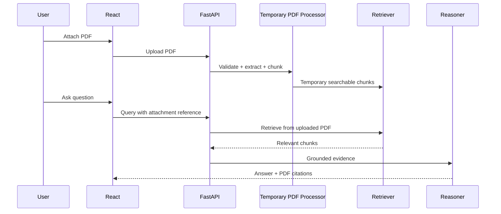
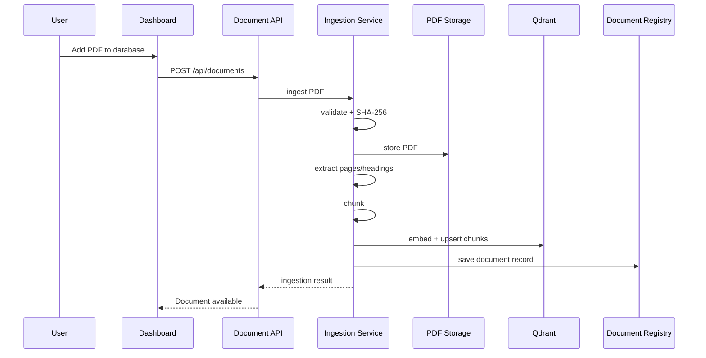

# ManufacturaIQ Dashboard — Architecture, Workflow, Configuration & Implementation Status

> **Project:** ManufacturaIQ — Manufacturing Engineering Copilot  
> **Current backend milestone:** STEP 16 complete  
> **Frontend direction:** Minimal ChatGPT-like engineering assistant with document upload, knowledge-base retrieval, cited responses, and optional structured manufacturing evidence.

---

## 1. Dashboard Goal

The dashboard should **not** behave like a dense analytics dashboard.

The intended user experience is a **clean AI assistant interface**, similar to ChatGPT, focused on engineering conversations and document-grounded retrieval.

### Primary user actions

The user should be able to:

- Start a new engineering conversation.
- Ask questions about manufacturing manuals, maintenance procedures, production issues, quality problems, alarms, etc.
- Retrieve information from PDFs already indexed in the ManufacturaIQ knowledge base.
- Upload a PDF temporarily for use in the current conversation.
- Add an uploaded PDF permanently into the ManufacturaIQ document knowledge base.
- Receive answers with document/source references.
- View only the most relevant source snippets/pages instead of a large analytics board.
- Continue conversations through a simple chat interface.
- See when an answer requires **human review**.

### Recommended UI layout

```text
┌──────────────────────────────────────────────────────────────────────┐
│ ManufacturaIQ                      Manufacturing Engineering Copilot │
├───────────────┬───────────────────────────────────┬──────────────────┤
│ Sidebar       │ Chat                              │ Sources          │
│               │                                   │                  │
│ + New Chat    │ User question                     │ Haas Manual      │
│ Knowledge     │                                   │ Page 174         │
│ Base          │ ManufacturaIQ answer              │                  │
│ Uploads       │                                   │ OSHA LOTO        │
│ History       │ [1] Source citation               │ Page 12          │
│               │                                   │                  │
│ PDF Library   │                                   │ + Add PDF        │
│               │                                   │   to database    │
├───────────────┴───────────────────────────────────┴──────────────────┤
│ [Attach PDF]  Ask about manuals, maintenance, production... [Send] │
└──────────────────────────────────────────────────────────────────────┘
```

---

# 2. Current Project Status

The backend pipeline has been implemented and validated through **STEP 16**.

## STEP 00 — Dataset Organization

Completed:

- Raw external datasets organized under canonical folders.
- Manifest and integrity tracking created.
- Source datasets preserved unchanged.
- SHA-256 validation used for canonical raw files.

External datasets include:

1. Industrial Maintenance Synthetic Dataset
2. Faulty Steel Plates
3. CNC Mill Tool Wear
4. Machine Predictive Maintenance Classification

Important rule:

> External datasets remain independent sources and are never falsely represented as one real manufacturing plant.

---

## STEP 01 — External Dataset Normalization

Completed normalization of external datasets into structured Parquet outputs.

Normalized domains include:

- Predictive maintenance
- CNC tool wear
- Steel quality faults
- Industrial maintenance

Each record preserves provenance such as:

- source dataset
- source file
- source record ID
- source row
- source domain
- external-source flag

No hidden merging of unrelated datasets is performed.

---

## STEP 02 — Synthetic Demo Factory

A coherent synthetic manufacturing environment was created separately from the external datasets.

### Demo factory entities

- Machines
- Products
- Production orders
- Maintenance logs
- Quality inspections
- Machine alarms
- Telemetry

### Example machines

- CNC-01
- CNC-03
- CNC-05

### Example products

- SHAFT-A
- GEAR-B
- HOUSING-C

Important rule:

> The application must never read evaluation-only hidden cause files such as `demo_cases.json` during runtime.

---

## STEP 03 — Technical Document Corpus

Current indexed PDF corpus contains:

- Siemens SINUMERIK 828D Milling manual
- Haas Lathe Operator Manual
- Haas Mill Operator Manual
- OSHA Lockout/Tagout documentation

Current validated corpus:

- **4 documents**
- **2,173 pages**
- staged page data
- metadata
- candidate headings

These documents are the basis of the current document retrieval system.

---

## STEP 04 — Shared Contracts & Protocols

Frozen contracts were created for:

- QueryRequest
- Evidence
- EvidenceProvenance
- AgentResult
- RoutingDecision
- EvidenceConflict
- EvidenceBundle
- EvidenceCitation
- ReasoningResult
- ReviewDecision

Frozen protocols include:

- Agent
- DocumentRetriever
- DecisionEngine
- EvidenceFusionService
- Reasoner
- ReviewGate / decision review behavior

These contracts act as the common language between every later component.

---

## STEP 05 — Operational SQLite Database

Canonical operational database:

```text
backend/data/manufacturaiq.db
```

Current tables:

- machines
- products
- production_orders
- maintenance_logs
- quality_inspections
- machine_alarms
- telemetry
- database_metadata

Repositories provide bounded read-only access patterns.

Important protections:

- no arbitrary SQL execution
- SELECT-only safety
- parameterized repository access
- external datasets are not imported into the operational demo-factory database

---

## STEP 06 — Hierarchical Document RAG

Current RAG stack:

- hierarchical document preprocessing
- BGE small embeddings
- local Qdrant vector store
- deterministic document metadata
- retrieval validation

Current index:

- **4 documents**
- **2,173 pages**
- **2,193 chunks**

Retrieval uses vector search plus a small lexical reranker.

Important:

> Document retrieval score is retrieval similarity only. It is not truth confidence.

---

## STEP 06A — RAG Hardening

Added:

- index integrity guards
- staged artifact checks
- retrieval evaluation
- reranking validation
- Qdrant single-client protection

Current validation baseline:

- RAG validation: **21/21 PASS**
- vector count: **2,193**

---

## STEP 07 — DocumentAgent

Responsibility:

> Retrieve relevant document/manual evidence for the user query.

Input:

```text
QueryRequest
```

Output:

```text
AgentResult
  └── DOCUMENT Evidence[]
```

DocumentAgent does not:

- diagnose
- reason
- perform maintenance analysis
- query production
- query quality
- call an LLM

---

## STEP 08 — MaintenanceAgent

Responsibility:

> Retrieve structured maintenance, alarm, and telemetry evidence.

Possible evidence types:

- maintenance history
- alarm history
- recurrence summary
- telemetry summary

It does not produce root-cause conclusions.

---

## STEP 09 — QualityAgent

Responsibility:

> Retrieve quality inspection evidence for machine/product/batch/time scope.

Possible evidence:

- inspection results
- measured values
- nominal values
- limits
- PASS/FAIL
- defect type
- aggregate quality summaries

It does not perform:

- SPC interpretation
- Cp/Cpk
- causal reasoning
- production correlation

---

## STEP 10 — ProductionAgent

Responsibility:

> Retrieve production execution and rejection evidence.

Possible evidence:

- production orders
- status
- planned quantity
- actual quantity
- accepted quantity
- rejected quantity
- reject summary

Production reject rate and quality inspection failure rate remain separate concepts.

---

## STEP 11 — Jev Decision Engine

Jev is used as a bounded routing layer.

### Architectural rule

```text
Jev decides WHAT should run.
LangGraph decides HOW / WHEN it runs.
```

Jev evaluates four independent routing judgments:

- DOCUMENT
- MAINTENANCE
- QUALITY
- PRODUCTION

Output:

```text
RoutingDecision.selected_agents
```

Fallback routing exists when Jev is unavailable.

---

## STEP 12 — Deterministic Evidence Fusion

Evidence Fusion receives all agent results and produces one deterministic bundle.

Responsibilities:

- query-ID validation
- evidence flattening
- identity deduplication
- provenance deduplication
- deterministic ordering
- source-integrity conflict detection

Output:

```text
EvidenceBundle
```

It does **not** determine truth or perform reasoning.

---

## STEP 13 — Grounded Gemini Reasoner

Gemini receives only:

```text
QueryRequest
+
EvidenceBundle
```

It does not access:

- database
- Qdrant
- repositories
- agents
- web tools
- hidden ground truth

Generated semantic sections include:

- observations
- possible causes
- recommended checks
- missing information
- final engineering analysis

Every grounded claim must reference actual evidence IDs.

Default model currently configured:

```text
gemini-3.8-flash
```

Default thinking:

```text
medium
```

---

## STEP 14 — Jev Final Review Gate

The Jev review gate evaluates the grounded Gemini reasoning.

Four review checks:

1. grounding failure
2. causal overreach
3. ignored conflict / evidence gap
4. unsafe recommendation

Output:

```text
ReviewDecision
```

Possible actions:

```text
PASS
HUMAN_REVIEW
```

Fail-closed rule:

> If review cannot be performed reliably, the result becomes `HUMAN_REVIEW`, never automatic PASS.

---

## STEP 15 — LangGraph Orchestration

LangGraph coordinates the existing components.

### Correct graph pattern

```text
START
  ↓
route
  ↓
conditional dispatch
  ├── DocumentAgent
  ├── MaintenanceAgent
  ├── QualityAgent
  └── ProductionAgent
          ↓
       fan-in
          ↓
   Evidence Fusion
          ↓
    Gemini Reasoner
          ↓
     Jev Review
          ↓
         END
```

Important implementation detail:

> `Send(...)` is emitted only from a conditional routing function registered with `add_conditional_edges(...)`. Ordinary graph nodes return state-update dictionaries.

LangGraph does not perform semantic agent selection. It executes the agents already selected by Jev.

---

## STEP 16 — FastAPI Layer

Implemented public endpoints:

```text
GET  /health
GET  /ready
POST /api/query
```

FastAPI is only an HTTP adapter around the existing orchestrator.

Current main endpoint flow:

```text
HTTP request
   ↓
API validation
   ↓
QueryRequest
   ↓
ManufacturaIQOrchestrator.run()
   ↓
API response
```

Current statuses:

- `needs_clarification`
- `pass`
- `human_review`

Current API does **not** yet include document upload or knowledge-base management endpoints.

---

# 3. Current Dashboard Direction

The new dashboard should be a **minimal document-aware assistant** rather than an analytics board.

## Left Sidebar

Recommended sections:

```text
+ New Chat

Knowledge Base
Uploads

History
  ├── Spindle vibration on CNC-05
  ├── Lockout Tagout procedure
  └── Tool change error alarm

PDF Library
  ├── Haas Mill Operator Manual.pdf
  ├── OSHA Lockout Tagout.pdf
  └── SINUMERIK 828D Manual.pdf
```

---

## Main Chat Area

Main interaction:

```text
User:
"What are the recommended steps to troubleshoot spindle vibration?"

ManufacturaIQ:
"Based on the retrieved manuals and maintenance evidence..."
```

The answer should remain concise and source-grounded.

Inline citation badges may appear as:

```text
[1]
[2]
[3]
```

Clicking them should open or highlight the corresponding source.

---

## Sources Panel

A small right-side panel may display:

```text
Sources

Haas Mill Operator Manual
Page 174

OSHA Lockout Tagout
Page 12

SINUMERIK 828D Manual
Page 214
```

Each source should show only:

- document title
- page / section
- short relevant excerpt

Avoid large evidence/analytics tables unless the user opens a detailed view.

---

# 4. Required PDF Features

The visual dashboard demo introduces three document workflows.

## A. Retrieve From Existing PDFs

Already largely supported through the existing RAG pipeline.

Current flow:

```text
User query
   ↓
DocumentAgent
   ↓
DocumentRetriever
   ↓
Qdrant
   ↓
Relevant existing document chunks
   ↓
Evidence
   ↓
Gemini
   ↓
Grounded response
```

This is already compatible with the current backend architecture.

---

## B. Upload PDF for Current Conversation

**Not yet implemented in STEP 16.**

Recommended behavior:

```text
User attaches PDF
   ↓
temporary upload
   ↓
validate PDF
   ↓
extract pages/text
   ↓
temporary chunking
   ↓
temporary embeddings/index
   ↓
retrieve against current query
   ↓
answer with citations
```

This should be separated from permanent knowledge-base ingestion.

Suggested future endpoint:

```text
POST /api/documents/query-upload
```

or an equivalent multipart workflow.

---

## C. Add PDF Permanently to Knowledge Base

**Not yet implemented in STEP 16.**

Recommended flow:

```text
User selects "Add PDF to database"
   ↓
POST PDF
   ↓
file validation
   ↓
document identity generation
   ↓
page extraction
   ↓
metadata extraction
   ↓
hierarchical chunking
   ↓
embedding generation
   ↓
Qdrant upsert
   ↓
document registry update
   ↓
ingestion report
   ↓
document becomes searchable
```

Recommended future endpoint:

```text
POST /api/documents
```

Recommended supporting endpoints:

```text
GET    /api/documents
GET    /api/documents/{document_id}
DELETE /api/documents/{document_id}
```

Deletion should only be implemented with controlled index/registry consistency.

---

# 5. Recommended Document Ingestion Architecture



---

# 6. Full ManufacturaIQ Architecture



---

# 7. Dashboard-Specific Architecture



---

# 8. Current Existing Configuration

## Python

Project interpreter:

```text
D:\CMTI\.venv\Scripts\python.exe
```

All project Python commands should continue using this exact interpreter.

---

## Database

Canonical DB:

```text
D:\CMTI\backend\data\manufacturaiq.db
```

Existing environment/config:

```env
DATABASE_URL=<configured database path/URL>
```

---

## Jev / TypeSafe

Existing environment:

```env
TYPESAFE_API_KEY=<your TypeSafe key>
```

Existing settings:

```text
jev_model = "jev-latest"
jev_route_threshold = 0.50
jev_timeout_seconds = 10.0
jev_max_retries = 1
jev_enabled = true

jev_review_threshold = 0.50
jev_review_enabled = true
```

---

## Gemini

Environment:

```env
GEMINI_API_KEY=<your Gemini API key>
```

Existing settings:

```text
gemini_model = "gemini-3.8-flash"
gemini_enabled = true
gemini_thinking_level = "medium"
gemini_timeout_seconds = 30.0
gemini_max_output_tokens = 8192
gemini_max_retries = 1
```

---

## Agent Limits

Existing important settings include:

```text
document_agent_top_k = 8

quality_agent_inspection_limit = 12
quality_agent_failure_limit = 8

production_agent_order_limit = 12
```

Maintenance agent has its own bounded retrieval settings already implemented.

---

## FastAPI / CORS

Existing local frontend origin:

```text
http://localhost:5173
```

Existing backend CORS configuration should include this through:

```text
cors_allowed_origins
```

Current public backend endpoints:

```text
GET  /health
GET  /ready
POST /api/query
```

---

# 9. Frontend Configuration

Recommended Vite configuration:

```env
VITE_API_BASE_URL=http://localhost:8000
```

Important:

> Anything prefixed with `VITE_` is visible in the browser bundle.

Never place:

```text
GEMINI_API_KEY
TYPESAFE_API_KEY
DATABASE_URL
```

in frontend environment variables.

---

# 10. Additional Configuration Required for PDF Upload

These settings are **proposed future configuration** and are not part of the completed STEP 16 API yet.

Recommended additions:

```env
DOCUMENT_UPLOAD_ENABLED=true

DOCUMENT_STORAGE_PATH=D:\CMTI\data\documents

DOCUMENT_MAX_UPLOAD_MB=50

DOCUMENT_ALLOWED_MIME_TYPES=application/pdf

DOCUMENT_INGEST_BATCH_SIZE=32
```

Potential Settings fields:

```text
document_upload_enabled: bool = True

document_storage_path: Path

document_max_upload_mb: int = 50

document_allowed_mime_types:
    ["application/pdf"]

document_ingest_batch_size: int = 32
```

Exact names may be adjusted to match the existing `Settings` style.

---

# 11. Recommended Document Registry

The current document corpus is built from staged artifacts.

For dynamic user-added PDFs, add a persistent document registry.

Recommended fields:

```text
document_id
filename
display_name
sha256
mime_type
file_size_bytes
page_count
manufacturer
document_type
machine_family
model
language
uploaded_at
ingestion_status
chunk_count
is_active
```

Possible storage:

```text
SQLite document registry table
+
original PDF files on controlled local storage
+
Qdrant embeddings/chunks
```

Do not store the entire PDF binary directly in operational SQLite unless intentionally designed that way.

---

# 12. Duplicate PDF Protection

Before permanent ingestion:

```text
PDF
 ↓
SHA-256
 ↓
Existing hash?
 ├── yes → reuse / reject duplicate
 └── no  → ingest
```

This avoids indexing the same manual multiple times.

---

# 13. PDF Validation

Before ingestion verify:

- file is actually PDF
- maximum size
- readable PDF structure
- page count > 0
- text extraction succeeds sufficiently
- filename sanitized
- no path traversal
- no executable interpretation
- deterministic document ID
- SHA-256 captured

Uploaded document text must be treated as **untrusted data**, not application instructions.

---

# 14. Knowledge-Base Update Workflow

Recommended permanent ingestion transaction:

```text
1. Accept PDF
2. Validate
3. Hash
4. Check duplicate
5. Store original
6. Extract page content
7. Extract metadata
8. Detect headings/sections
9. Chunk hierarchically
10. Generate embeddings
11. Upsert Qdrant
12. Write document registry
13. Validate vector/document counts
14. Mark document ACTIVE
```

If a failure occurs before completion:

```text
status = INGESTION_FAILED
```

Do not expose partially ingested documents to DocumentAgent.

---

# 15. Document Deletion Workflow

If document deletion is later supported:

```text
Delete request
   ↓
verify document exists
   ↓
remove / disable Qdrant chunks
   ↓
update document registry
   ↓
remove original file or archive
   ↓
validate no orphan chunks
```

Deletion should never leave:

- dangling Qdrant vectors
- missing registry entries
- stale searchable chunks

---

# 16. Recommended Chat Workflow



---

# 17. PDF Upload Conversation Workflow

For a user-attached temporary PDF:



This feature is **future work** and is not implemented in the current STEP 16 API.

---

# 18. Permanent Knowledge-Base Upload Workflow



---

# 19. Recommended Future API Additions

Current STEP 16 API should remain untouched until a dedicated document-ingestion stage is approved.

Recommended next document endpoints:

```text
GET    /api/documents
POST   /api/documents
GET    /api/documents/{document_id}
DELETE /api/documents/{document_id}

POST   /api/uploads/session
DELETE /api/uploads/session/{upload_id}
```

Possible retrieval endpoint if needed separately:

```text
POST /api/documents/search
```

However, normal user questions should continue through:

```text
POST /api/query
```

to preserve the complete routing → evidence → reasoning → review pipeline.

---

# 20. Recommended Frontend Pages / Views

For the minimal product, avoid many pages.

## Chat

Main dashboard.

Contains:

- history
- message list
- source references
- PDF attach
- send

## Knowledge Base

Can be a drawer/modal or separate simple view.

Contains:

- document name
- document type
- manufacturer
- pages
- ingestion date
- status
- remove action if supported

## Uploads

Optional simple ingestion status view.

Contains:

```text
Uploading
Processing
Indexed
Failed
```

Avoid analytics unless genuinely useful.

---

# 21. Response Presentation

The default chat response should primarily show:

```text
Engineering answer
+
source citation markers
```

Optional expandable sections:

```text
Sources
Evidence
Possible causes
Recommended checks
Human review information
```

Do not show every internal contract field by default.

The backend can remain evidence-rich while the UI remains minimal.

---

# 22. Recommended Source Citation UX

Example:

```text
Inspect spindle runout using the procedure in the Haas Mill
Operator Manual. [1]

Before maintenance, isolate hazardous energy using the documented
lockout/tagout procedure. [2]
```

Source drawer:

```text
[1] Haas Mill Operator Manual
    Page 174

[2] OSHA Lockout/Tagout
    Page 12
```

Clicking citation:

```text
[1]
 ↓
highlight corresponding source
 ↓
optionally open PDF preview at cited page
```

PDF preview/page jumping is a frontend enhancement and should not modify the evidence identity.

---

# 23. Human Review UX

If backend returns:

```text
HUMAN_REVIEW
```

Display compactly:

```text
Human review recommended
```

Do not treat it as application failure.

Expandable detail may show review reasons.

The chat answer can remain visible while clearly marking that a human engineer should verify it before operational action.

---

# 24. Minimal UI State

Recommended frontend state:

```text
idle
uploading
submitting
success
error
```

Business status remains backend-controlled:

```text
needs_clarification
pass
human_review
```

Do not duplicate Jev/LangGraph workflow logic in React.

---

# 25. Important Security Boundaries

Never expose to browser:

```text
GEMINI_API_KEY
TYPESAFE_API_KEY
DATABASE_URL
Qdrant internal paths
local filesystem paths
hidden evaluation data
```

Never allow uploaded PDF contents to override system instructions.

Never execute content embedded inside PDFs.

Treat PDF content as untrusted retrieval data.

---

# 26. Current Missing Capabilities for the New Dashboard

Before the generated dashboard can be fully functional, the following backend capabilities still need to be implemented:

### Required

- Dynamic PDF upload API
- PDF validation service
- original document storage
- document registry
- incremental page extraction
- hierarchical chunk creation
- incremental embedding generation
- Qdrant upsert
- document listing API
- ingestion-status API
- duplicate PDF detection
- optional document deletion

### Already available

- existing PDF retrieval
- document RAG
- provenance
- document evidence
- grounded reasoning
- evidence-ID citations
- multi-domain agent workflow
- final Jev review
- FastAPI query endpoint

---

# 27. Recommended Implementation Order From Here

## STEP 17A

Build the minimal React chat frontend using current APIs.

Use:

```text
POST /api/query
GET /health
GET /ready
```

Initially, the Upload button may be visually disabled or marked:

```text
Coming next
```

if dynamic upload backend is not yet implemented.

Do not fake successful PDF ingestion.

---

## STEP 17B

Frontend:

- tests
- build
- responsive layout
- citations
- evidence/source drawer
- clarification state
- PASS/HUMAN_REVIEW state

Freeze frontend.

---

## Recommended STEP 17C / New Document Ingestion Stage

Before declaring the generated dashboard completely functional, implement:

```text
Document Upload + Dynamic Knowledge-Base Ingestion
```

This should be a dedicated backend stage rather than hiding ingestion logic inside React.

---

## STEP 18

Formal system evaluation.

Evaluate:

- routing correctness
- retrieval
- cross-domain evidence use
- grounded reasoning
- citation validity
- causal-overreach behavior
- human-review behavior
- fallback behavior

---

# 28. Final Target Architecture

```text
                        ManufacturaIQ
                             │
                             ▼
                    React Chat Dashboard
                             │
             ┌───────────────┴────────────────┐
             │                                │
             ▼                                ▼
       Engineering Query                PDF Management
             │                                │
             ▼                                ▼
          FastAPI                       Upload API
             │                                │
             ▼                                ▼
         LangGraph                      Ingestion Service
             │                                │
        Jev Routing                            ├─ Validate
             │                                ├─ Extract
        Agent Fan-out                         ├─ Chunk
     ┌───────┼────────┐                       ├─ Embed
     ▼       ▼        ▼                       └─ Qdrant
 Document Maintenance Quality Production          │
     └───────┼────────┘                           │
             ▼                                    │
       Evidence Fusion ◄──────────────────────────┘
             │
             ▼
       Gemini Reasoner
             │
             ▼
       Jev Review Gate
             │
      ┌──────┴──────┐
      ▼             ▼
     PASS       HUMAN_REVIEW
      │             │
      └──────┬──────┘
             ▼
        FastAPI Response
             │
             ▼
       Minimal Chat UI
       + Source Citations
```

---

# 29. Core Design Principle

The backend can remain **deep and evidence-rich**, while the dashboard stays **simple**.

The user should mostly experience:

```text
Ask
 ↓
Retrieve
 ↓
Reason
 ↓
Cite
 ↓
Review
 ↓
Answer
```

The UI should not expose every internal agent, metric, evidence score, routing probability, or workflow state unless the user explicitly opens a detailed engineering view.

This maintains the technical strength of ManufacturaIQ without turning the interface into an overloaded analytics dashboard.
